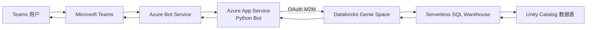
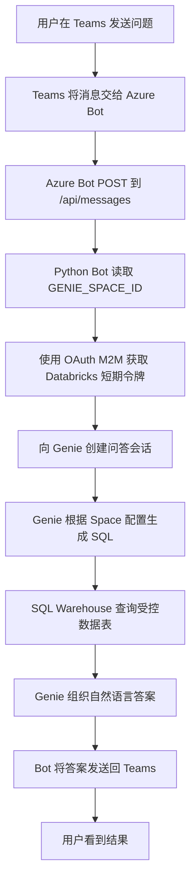

# Microsoft Teams 调用 Databricks Genie 问数 Demo

本项目让用户在 Microsoft Teams 中直接用自然语言查询 Databricks 数据。例如：

> 数据集中一共有多少次行程？

Bot 会把问题交给 Databricks Genie。Genie 根据已配置的数据表生成 SQL、运行查询，并把答案发回 Teams。

## 一句话说明

Teams 负责聊天入口，Azure Bot Service 负责转发消息，Azure App Service 运行 Python Bot，Databricks Genie 负责理解问题和查询数据。

当前生产链路采用 **Databricks OAuth M2M 应用身份**。所有 Teams 用户共享同一个 Databricks 服务主体，不要求 Teams 与 Azure 位于同一租户。

## 当前资源

| 资源 | 当前值 | 用途 |
| --- | --- | --- |
| Azure 订阅 | `4c70bcd9-6988-4707-86d0-39ff8b491d3c` | 承载 Azure 资源 |
| 资源组 | `databricksdemo-rg` | Demo 资源容器 |
| Databricks workspace | `databricksdemo` | 数据、Genie 和模型服务 |
| Azure Bot | `botservicedatabricks` | Teams channel 和消息转发 |
| App Service | `botservicedatabricks-app` | 运行 Python Bot |
| App Service Plan | `yute_asp_2821`，Linux B1 | Bot 计算资源 |
| Genie Space | `Teams NYC Taxi Data` | 自然语言问数 |
| Genie Space ID | `01f1b0efb5c211b2b08b9571d261f0ef` | Bot 调用目标 |
| SQL Warehouse | `Teams Demo SQL Warehouse` | 执行 Genie 生成的 SQL |
| Warehouse ID | `eca894b403d9f424` | Genie 计算资源 |
| 数据表 | `databricksdemo.default.nyctaxi_trips` | Demo 查询数据 |

App Service B1 会持续计费。SQL Warehouse 使用 Serverless `2X-Small`，空闲 10 分钟自动停止，使用和冷启动期间计费。

## 架构图



## 组件职责

| 组件 | 作用 | 不负责的内容 |
| --- | --- | --- |
| Microsoft Teams | 提供个人聊天、群聊和团队频道入口，展示文本与 Adaptive Card | 不运行 Bot 或 AI 推理代码 |
| Teams 应用 manifest | 声明应用名称、Bot ID、可用范围和有效域名，供 Teams 安装与识别应用 | 不托管服务，也不处理消息 |
| Azure Bot Service | 注册 Microsoft Teams channel，将 Teams Activity 转发到 `/api/messages`，并把 Bot 回复送回 Teams | 不运行本仓库的 Python 代码，不调用 Databricks |
| Azure App Service | 托管 Python Bot，提供公网 HTTPS 消息端点，负责日志、扩缩容和运行时环境 | 不执行模型推理或 SQL 查询 |
| Python Bot | 验证和处理 Bot Framework Activity，将 Teams 消息转换为 Databricks 请求，并将结果转换为 Teams 回复 | 不负责生成 SQL 或访问底层数据表 |
| Azure Bot 用户分配托管身份 | 供 App Service 上的 Bot Framework 验证 Azure Bot/Teams 消息链路 | 当前不作为 Databricks 查询身份 |
| Databricks 服务主体 | 通过 OAuth M2M 获取短期令牌，以共享应用身份访问授权的 Genie、Warehouse 和数据表 | 不代表单个 Teams 用户，不能提供用户级数据隔离 |
| Databricks Genie Space | 理解自然语言问题，基于 Space 指令和已授权数据生成查询并组织答案 | 不承载 Teams 消息入口 |
| Serverless SQL Warehouse | 执行 Genie 生成的 SQL，提供查询计算资源 | 不理解自然语言或管理 Teams 会话 |
| Unity Catalog | 管理 catalog、schema、数据表及其访问权限，提供受治理的数据来源 | 不执行 Bot 或 Agent 逻辑 |

Azure Bot Service 是消息路由和 channel 注册资源，App Service 才是实际运行 Python Bot 的计算平台。删除或停止 App Service 后，即使 Azure Bot 和 Teams 应用仍然存在，也没有服务处理 `/api/messages` 请求。


## 一次问答的流程



SQL Warehouse 冷启动时，第一条问题可能需要几十秒。Bot 使用工作线程等待 Genie，避免阻塞 App Service 的 Web 事件循环。

## 身份认证

这里有两条互不相同的认证链路。

### Teams 到 Bot

- Azure Bot 类型为 `UserAssignedMSI`。
- App Service 附加 Azure Bot 的用户分配托管身份。
- Bot Framework 使用该身份验证 Teams 发来的活动。
- Teams 租户可以与 Azure/Databricks 租户不同。

### Bot 到 Databricks

- App Service 使用 `DATABRICKS_CLIENT_ID` 和 `DATABRICKS_CLIENT_SECRET`。
- Databricks SDK 使用 `oauth-m2m` 获取短期访问令牌并自动刷新。
- 运行身份只获得 Genie Space、Warehouse 和指定数据表所需权限。
- 不使用 Teams 用户身份，因此 Databricks 审计中显示共享服务主体，而不是每个 Teams 用户。

此模式适合 Demo 和共享权限场景。如果生产环境必须按 Teams 用户做数据权限隔离，需要重新设计为用户委托/OBO，并解决跨租户用户映射和管理员同意。

## 部署步骤

以下步骤描述从零搭建相同 Demo 的顺序。已有资源时可跳过对应步骤。

### 1. 准备 Databricks 数据

1. 选择要让 Genie 查询的 Unity Catalog 表。
2. 不建议直接依赖只读系统样例 catalog。将 Demo 数据放到自己管理的 catalog/schema。
3. 本项目使用：

```sql
CREATE OR REPLACE TABLE databricksdemo.default.nyctaxi_trips AS
SELECT * FROM samples.nyctaxi.trips;
```

### 2. 创建 SQL Warehouse

创建一个 Serverless SQL Warehouse：

- 名称：`Teams Demo SQL Warehouse`
- 大小：`2X-Small`
- 自动停止：10 分钟
- 最小/最大集群数：1

生产环境应根据并发量、预算和响应时间调整规格。

### 3. 创建 Genie Space

1. 在 Databricks 中打开 Genie。
2. 创建 Space 并选择 SQL Warehouse。
3. 添加 `databricksdemo.default.nyctaxi_trips` 为数据源。
4. 添加清晰的数据说明和示例问题。
5. 记录 Space ID。

当前示例指令要求 Genie 仅从指定表回答，并在数据无法回答时明确说明。

### 4. 创建 Databricks 服务主体

通过工作区管理页面创建或选择 Databricks service principal：

1. 使用 Workspace admin 账号登录 Azure Databricks 工作区。
2. 单击右上角用户名，选择 **Settings**。
3. 进入 **Identity and access**。
4. 在 **Service principals** 旁单击 **Manage**。
5. 单击 **Add service principal**。
6. 根据实际情况选择：
   - 已有 service principal：从列表中选择，配置所需的 workspace entitlements，然后单击 **Add**。
   - 新建 service principal：单击 **Add new**，选择 **Databricks managed**，输入名称，然后单击 **Add**。

为新建的 Databricks-managed service principal 生成 OAuth M2M secret：

1. 在 **Service principals** 页面选择刚创建的 service principal。
2. 打开 **Secrets**，单击 **Generate secret**。
3. 设置有效期，并仅选择应用所需的 API scopes。
4. 单击 **Generate**，立即复制并安全保存 client ID 和 secret。

为 service principal 授予以下最小权限：

| 对象 | 最小权限 |
| --- | --- |
| Genie Space | `CAN RUN` |
| Catalog | `USE CATALOG` |
| Schema | `USE SCHEMA` |
| 表 | `SELECT` |

具体操作：

1. 授予 Genie Space 权限：
   1. 打开前面创建的 Genie Space。
   2. 单击右上角 **Share**。
   3. 搜索并添加 service principal。
   4. 将权限设置为 **Can run**，然后保存。
2. 授予 Unity Catalog 数据权限：
   1. 打开 **SQL Editor**，选择一个可用的 SQL Warehouse。
   2. 使用具有对象所有者、`MANAGE` 或 metastore admin 权限的账号执行以下语句，将占位符替换为 service principal 的 application ID：

      ```sql
      GRANT USE CATALOG ON CATALOG databricksdemo
      TO `<service-principal-application-id>`;

      GRANT USE SCHEMA ON SCHEMA databricksdemo.default
      TO `<service-principal-application-id>`;

      GRANT SELECT ON TABLE databricksdemo.default.nyctaxi_trips
      TO `<service-principal-application-id>`;
      ```

3. Genie 使用配置者嵌入的 SQL Warehouse 凭据执行查询，因此调用 Genie 的 service principal 不需要 SQL Warehouse 的 `CAN USE` 权限。配置 Genie Space 所用 Warehouse 的用户必须具有 `CAN USE`。如果 service principal 还需要绕过 Genie 直接执行 SQL，则打开 **SQL Warehouses**，在目标 Warehouse 的菜单中选择 **Permissions**，添加该 service principal，并授予 **Can use**。

如果在 **Share** 或 **Permissions** 中搜索不到 service principal，请先确认它已添加到当前 workspace。

OAuth secret 只在创建时显示一次。不要写入代码、Git、README、Teams 消息或聊天记录。

### 5. 创建 Azure Bot 和 App Service

#### 5.1 创建 Azure Bot 并启用 Microsoft Teams channel

1. 登录 [Azure Portal](https://portal.azure.com)，搜索并打开 **Azure Bot**，然后单击 **Create**。
2. 在创建页面中填写：
   - **Bot handle**：全局唯一的 Bot 资源名称。
   - **Subscription** 和 **Resource group**：选择本项目使用的订阅和资源组。
   - **Pricing tier**：开发或演示环境可选择 `F0`；如果订阅中无法再创建 `F0`，请选择 `S1`。
   - **Type of App**：选择 **User-Assigned Managed Identity**。
3. 在身份选择区域新建或选择一个 user-assigned managed identity。后续 Azure Bot 和 App Service 使用这个身份。
4. 单击 **Review + create**，验证通过后单击 **Create**。
5. 部署完成后打开该 Azure Bot，记录其 user-assigned managed identity 的以下值：
   - **Client ID**：后续用作 `MicrosoftAppId`。
   - **Resource ID**：用于确认和附加正确的托管身份。
   - **Tenant ID**：后续用作 `MicrosoftTenantId`。
6. 在 Azure Bot 左侧菜单中打开 **Channels**。
7. 选择 **Microsoft Teams**，接受服务条款，根据组织策略选择商业版 Teams，然后单击 **Apply** 或 **Save**。
8. 确认 Microsoft Teams channel 的状态为 `Succeeded`。

Azure Bot 和 App Service 必须使用同一个 user-assigned managed identity。当前主流程使用第 4 节创建的独立 Databricks-managed service principal 和 OAuth M2M secret 访问 Databricks，因此 Databricks service principal 的 Client ID 与 Azure Bot 托管身份的 Client ID 不需要相同。

#### 5.2 创建 Linux App Service

1. 在 Azure Portal 中搜索并打开 **App Services**，单击 **Create** > **Web App**。
2. 在 **Basics** 页面填写：
   - **Subscription** 和 **Resource group**：建议与 Azure Bot 相同。
   - **Name**：输入全局唯一的名称，例如 `botservicedatabricks-app`。该名称会成为默认域名的一部分。
   - **Publish**：选择 **Code**。
   - **Runtime stack**：选择 **Python 3.13**。
   - **Operating System**：选择 **Linux**。
   - **Region**：选择靠近用户且符合数据驻留要求的区域。
3. 创建或选择 App Service plan：
   - **Linux Plan**：可新建一个计划。
   - **Pricing plan**：选择 `B1` 或更高规格。`F1` 等共享层不适合持续运行的生产 Bot。
4. 其他设置暂时保持默认，单击 **Review + create**。
5. 验证通过后单击 **Create**。部署完成后打开 App Service，并确认 **Overview** 页面中的状态为 `Running`。
6. 记录 App Service 的 **Default domain**，通常为：

   ```text
   https://<app-service-name>.azurewebsites.net
   ```

此时只创建了运行环境，项目代码将在后续部署步骤中上传。

#### 5.3 将 Azure Bot 的用户分配托管身份附加到 App Service

1. 打开刚创建的 App Service。
2. 在左侧菜单中选择 **Settings** > **Identity**。
3. 打开 **User assigned** 选项卡，单击 **Add**。
4. 选择 Azure Bot 创建时使用的同一个 user-assigned managed identity，然后单击 **Add**。
5. 刷新页面，确认该身份出现在 **User assigned** 列表中。
6. 打开该身份并再次核对 **Client ID**。它必须与 Azure Bot 使用的 Microsoft App ID 一致。

仅创建 Azure Bot 身份并不会自动将它附加到 App Service。缺少这一步时，Python Bot 无法以 `UserAssignedMSI` 身份完成 Bot Framework 身份验证。

#### 5.4 配置 Azure Bot messaging endpoint

1. 确认 App Service 已创建，并记下其默认域名。
2. 返回 Azure Bot 资源。
3. 在左侧菜单中打开 **Settings** > **Configuration**。
4. 将 **Messaging endpoint** 设置为：

```text
https://<app-service-name>.azurewebsites.net/api/messages
```

例如，本项目示例为：

```text
https://botservicedatabricks-app.azurewebsites.net/api/messages
```

5. 单击 **Apply** 或 **Save**。

Messaging endpoint 必须使用公网 HTTPS 地址，并以 `/api/messages` 结尾。不要填写 App Service 的 SCM/Kudu 地址，也不要在结尾额外添加 `/`。

#### 5.5 配置 App Service 启动命令

1. 打开 App Service。
2. 在左侧菜单中选择 **Settings** > **Configuration**，然后打开 **General settings**。
3. 确认 Stack settings 中的运行时为 **Python 3.13**。
4. 在 **Startup Command** 中输入：

```text
python3 app.py
```

5. 单击 **Save**，确认后等待 App Service 重启。

该命令假设后续部署时将 `teams-bot/` 目录中的内容部署到 App Service 应用根目录，使 `app.py` 位于 `/home/site/wwwroot/app.py`。如果部署的是整个仓库而不是 `teams-bot/` 目录，则启动命令应改为：

```text
python3 teams-bot/app.py
```

应用启动后监听 `0.0.0.0:8000`。完成代码部署和第 6 节的环境变量配置后，可以在 **Monitoring** > **Log stream** 中确认应用成功启动。直接在浏览器中访问 `/api/messages` 返回 `405 Method Not Allowed` 属于正常现象，因为该端点只接受 Bot Framework 发出的 `POST` 请求。

### 6. 配置 App Service 环境变量

| 变量 | 说明 |
| --- | --- |
| `MicrosoftAppId` | Azure Bot 托管身份 client ID |
| `MicrosoftAppType` | `UserAssignedMSI` |
| `MicrosoftTenantId` | Azure Bot 所在 Entra tenant ID |
| `DATABRICKS_HOST` | Databricks workspace URL，不带 `/api` |
| `DATABRICKS_AUTH_TYPE` | `oauth-m2m` |
| `DATABRICKS_CLIENT_ID` | Databricks service principal client ID |
| `DATABRICKS_CLIENT_SECRET` | Databricks OAuth M2M secret |
| `GENIE_SPACE_ID` | Genie Space ID |
| `SERVING_ENDPOINT_NAME` | 可选；未配置 Genie 时使用的 Model Serving endpoint |
| `SCM_DO_BUILD_DURING_DEPLOYMENT` | `True` |

当前只要设置了 `GENIE_SPACE_ID`，Bot 就优先直连 Genie，不再调用 `SERVING_ENDPOINT_NAME`。

推荐通过 Key Vault reference 提供 `DATABRICKS_CLIENT_SECRET`。Demo 当前存放在 App Service setting 中，必须限制资源读取权限并定期轮换。

### 7. 部署 Bot 代码

在 [`teams-bot`](teams-bot) 目录执行：

```bash
az webapp up \
	--subscription <subscription-id> \
	--resource-group <resource-group> \
	--name <web-app-name> \
	--runtime "PYTHON:3.13"
```

部署完成后，`GET /api/messages` 返回 `405 Method Not Allowed` 是正常现象，因为该路由只接受 Bot Framework 的 `POST`。

### 8. 上传 Teams 应用

1. 打开 Teams。
2. 进入“应用” → “管理你的应用”。
3. 选择“上传自定义应用”。
4. 上传 [`teams-databricks-agent.zip`](teams-bot/teams-databricks-agent.zip)。
5. 将应用添加到个人聊天、团队或群聊。

manifest 已支持：

- `personal`：个人聊天
- `team`：团队频道，需要 `@Bot名称 问题`
- `groupChat`：多人群聊

如果 Teams 中没有“上传自定义应用”，需要租户管理员在 Teams 管理中心上传并允许该应用。

## 当前主链路与自定义 Agent

仓库中的 [`databricks-agent`](databricks-agent) 包含一个 MLflow `ResponsesAgent` 示例，并注册为：

```text
databricksdemo.default.teams_demo_agent
```

它可用于学习 Model Serving Agent 的注册与滚动部署。但当前生产 Bot **直接调用 Genie**，原因是这种共享 M2M 身份模式更简单，也避免 Model Serving Agent 内再次委托 Genie 时的用户 OBO 限制。

如果未来改回 Model Serving Agent，请清空 `GENIE_SPACE_ID` 并设置 `SERVING_ENDPOINT_NAME`，同时重新验证 Agent runtime 对所有下游资源的认证方式。

## 验证清单

按以下顺序排查最省时间：

1. App Service 状态为 `Running`。
2. 浏览器访问根路径返回 `404`，访问 `/api/messages` 返回 `405`。
3. Azure Bot messaging endpoint 指向正确 App Service。
4. Microsoft Teams channel 状态为 `Succeeded`。
5. App Service 中 `DATABRICKS_AUTH_TYPE=oauth-m2m`。
6. `GENIE_SPACE_ID` 正确。
7. 服务主体能直接调用 Genie 并获得答案。
8. 在 Teams 中发送真实数据问题并等待冷启动完成。

本项目已通过端到端验证：

```text
问题：How many trips are in the dataset?
答案：The dataset contains 21,932 trips.
```

## 可测试的问题

- 数据集中一共有多少次行程？
- 平均行程距离是多少？
- 平均车费是多少？
- 行程数量最多的 10 个上车邮编是什么？
- 哪个下车邮编的平均车费最高？
- 按月统计行程数量。
- 长距离和短距离行程的平均费用有何差异？

## 常见问题

### Teams 没有回复

依次检查：

1. App Service 是否正在部署、重启或停止。
2. Azure Bot endpoint 和 Teams channel 是否正确。
3. App Service 日志中是否出现 `POST /api/messages`。
4. 是否出现 `Agent is not available at this moment.`。
5. Genie/SQL Warehouse 是否正在冷启动。

### Direct Line 返回 502，但稍后仍收到答案

Genie 查询可能超过 Direct Line 投递请求的同步等待时间。Bot 会继续处理，并可能通过活动流稍后返回答案。Teams 通常会显示稍后的回复。若生产环境对延迟敏感，应增加即时“正在查询”消息，并把长任务改为完全异步处理。

### `PERMISSION_DENIED`

确认服务主体具备 Genie、Warehouse、catalog、schema 和表的全部最小权限。只拥有 `CAN USE` Warehouse 并不足以读取数据表。

### `Agent is not available at this moment.`

这是 Bot 的统一错误消息。查看 App Service 日志中的原始异常，常见原因包括：

- OAuth secret 过期或被撤销
- Genie Space ID 错误
- Warehouse 或数据权限缺失
- Warehouse 启动/查询失败
- Databricks workspace URL 配置错误

### 首次回复很慢

Serverless Warehouse 空闲后会停止。首次问题需要重新启动 Warehouse，后续问题通常更快。可以延长自动停止时间来换取更低延迟，但会增加费用。

## 安全与运维

- 立即轮换任何曾出现在聊天、终端历史或日志中的 PAT/secret。
- 不要使用个人 PAT 作为长期生产凭据。
- 优先使用短期 OAuth M2M token，由 SDK 自动刷新。
- 定期轮换 `DATABRICKS_CLIENT_SECRET`。
- 生产环境使用 Key Vault reference。
- 只给服务主体授予指定 Space、Warehouse 和表权限。
- 当前所有 Teams 用户共享同一数据权限和 Databricks 审计身份。
- 使用 App Service 与 Databricks 日志监控失败率和响应时间。
- 不使用 Demo 时停止或删除 B1 App Service Plan 和 SQL Warehouse，避免继续计费。

## 目录结构

```text
teams-databricks-bot-service/
├── databricks-agent/        # 可选的 MLflow ResponsesAgent 示例
├── teams-bot/               # 当前 Teams Bot 主应用
│   ├── app.py               # aiohttp Web 入口
│   ├── config.py            # 环境变量映射
│   ├── client/              # Databricks/Genie 客户端
│   ├── dialogs/             # 对话逻辑
│   └── appManifest/         # Teams manifest 和图标
└── README.md                # 本说明文档
```
# 参考文档
https://learn.microsoft.com/zh-cn/azure/databricks/agents/custom-agents/teams-agent
