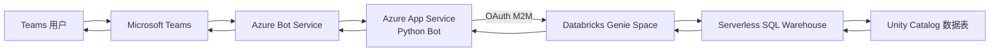
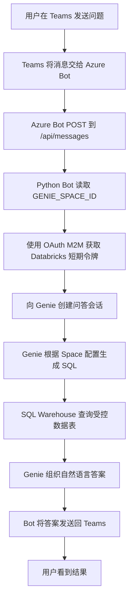

# Microsoft Teams 调用 Databricks Genie 问数 Demo

本项目让用户在 Microsoft Teams 中直接用自然语言查询 Databricks 数据。例如：

> 数据集中一共有多少次行程？

Bot 会把问题交给 Databricks Genie。Genie 根据已配置的数据表生成 SQL、运行查询，并把答案发回 Teams。

## 一句话说明

Teams 负责聊天入口，Azure Bot Service 负责转发消息，Azure App Service 运行 Python Bot，Databricks Genie 负责理解问题和查询数据。

本文的默认 Demo 链路采用 **Databricks OAuth M2M 应用身份**。所有 Teams 用户共享同一个 Databricks 服务主体，不使用 Teams 用户登录 Databricks。


## 开始前

- 准备可用的 Azure 订阅及资源组、启用 Unity Catalog 的 Databricks workspace、可用的 Pro 或 Serverless SQL Warehouse，以及可使用自定义应用的 Teams 账号。
- 本地部署工具使用 Azure CLI 和 Python 3.13；生成 Teams 包可使用 `zip` 或其他 ZIP 压缩工具。所需平台权限见后文“权限”，应在创建资源前向管理员确认。
- 获取当前项目后，以项目根目录为起点执行本文命令；进入子目录的命令不应在同一个终端反复累加执行。
- [原始上游示例](https://github.com/databricks-solutions/databricks-bot-service/tree/main/teams-bot) 使用用户 OAuth 登录和 token exchange。当前项目已修改为共享应用身份；仅复制上游示例并填写本文环境变量，不会自动获得当前行为。
- 当前主链路只需部署 [`teams-bot`](teams-bot)。不要先运行 [`databricks-agent/deploy.py`](databricks-agent/deploy.py)；它是可选 Model Serving 示例，会创建独立资源。

## Demo 资源示例

以下为已有 Demo 的参考值，不是新环境的默认配置，也不代表资源当前在线。新部署请替换为自己的资源、ID 和域名。

| 资源 | Demo 示例值 | 用途 |
| --- | --- | --- |
| Azure 订阅 | `4c70bcd9-6988-4707-86d0-39ff8b491d3c` | 承载 Azure 资源 |
| 资源组 | `databricksdemo-rg` | Demo 资源容器 |
| Databricks workspace | `databricksdemo` | 数据、Genie 和模型服务 |
| Azure Bot | `botservicedatabricks` | Teams channel 和消息转发 |
| App Service | `botservicedatabricks-app` | 运行 Python Bot |
| App Service Plan | `yute_asp_2821`，Linux B1 | Bot 计算资源 |
| Genie Space | `Teams NYC Taxi Data` | 自然语言问数 |
| Genie Space ID | `01f1b0efb5c211b2b08b9571d261f0ef` | Bot 调用目标 |
| SQL Warehouse | `Teams Demo SQL Warehouse` | 执行 Genie 生成的 SQL |
| Warehouse ID | `eca894b403d9f424` | Genie 计算资源 |
| 数据表 | `databricksdemo.default.nyctaxi_trips` | Demo 查询数据 |

App Service B1 会持续计费。SQL Warehouse 使用 Serverless `2X-Small`，空闲 10 分钟自动停止，使用和冷启动期间计费。

## 架构图



## 组件职责

| 组件 | 作用 |
| --- | --- |
| Microsoft Teams | 提供个人聊天、群聊和团队频道入口；当前 Genie 路径发送文本，可选 Model Serving 工具调用路径可生成 Adaptive Card |
| Teams 应用 manifest | 声明应用名称、Bot ID、可用范围和有效域名，供 Teams 安装与识别应用 |
| Azure Bot Service | 注册 Microsoft Teams channel，将 Teams Activity 转发到 `/api/messages`，并把 Bot 回复送回 Teams |
| Azure App Service | 托管 Python Bot，提供公网 HTTPS 消息端点，负责日志、扩缩容和运行时环境 |
| Python Bot | 验证和处理 Bot Framework Activity，将 Teams 消息转换为 Databricks 请求，并将结果转换为 Teams 回复 |
| Azure Bot 用户分配托管身份 | 供 App Service 上的 Bot Framework 验证 Azure Bot/Teams 消息链路 |
| Databricks 服务主体 | 通过 OAuth M2M 获取短期令牌，以共享应用身份访问授权的 Genie 和数据表；Warehouse 计算访问由 Genie 配置者提供 |
| Databricks Genie Space | 理解自然语言问题，基于 Space 指令和已授权数据生成查询并组织答案 |
| Serverless SQL Warehouse | 执行 Genie 生成的 SQL，提供查询计算资源 |
| Unity Catalog | 管理 catalog、schema、数据表及其访问权限，提供受治理的数据来源 |

Azure Bot Service 是消息路由和 channel 注册资源，App Service 才是实际运行 Python Bot 的计算平台。删除或停止 App Service 后，即使 Azure Bot 和 Teams 应用仍然存在，也没有服务处理 `/api/messages` 请求。


## 一次问答的流程



SQL Warehouse 冷启动时，第一条问题可能需要几十秒或更久。Bot 将 Genie 的同步等待调用放到工作线程，但 HTTP 请求仍在等待本次问答；这不是持久化后台任务，也没有实现即时“正在查询”提示或完整的超时恢复机制。

## 当前能力与限制

| 项目 | 当前代码行为 |
| --- | --- |
| Genie 问答 | 每条问题调用 `start_conversation_and_wait`，创建新的 Genie 会话；不复用 conversation ID，因此不支持依赖上一轮的追问 |
| 返回结果 | 只提取 Genie 的文本附件；没有读取 SQL 查询结果并渲染完整表格、图表或下载文件。没有文本附件时会提示调用失败 |
| 对话历史 | 历史保存在 App Service 进程的 `MemoryStorage` 中；仅可选 Model Serving 路径将历史传给模型，Genie 路径不使用这段历史 |
| 重启 / 扩容 | 重启会丢失内存状态，多实例之间不共享状态；历史尚无持久化、长度限制或独立的多人会话隔离设计 |
| `clear` | 只删除 `DialogState`，不删除 `history`，不清除 Teams 消息或 Genie 会话；不是完整的“清空历史”功能 |
| `logout` | 默认 M2M 路径没有用户登录会话；欢迎语中的 logout 提示是旧示例遗留，不能用于撤销共享服务主体凭据 |
| 频道 / 群聊 | manifest 声明了相关 scope，但默认需要 `@Bot`；当前代码没有显式去除消息中的 Bot mention，频道命令和提问文本需实际验证 |

建议先在个人聊天验证独立、完整的问题，再测试团队频道和群聊。生产化前需要根据业务补充状态持久化、历史限制、mention 清理、并发隔离和长查询处理；本文不声称这些功能已经实现。


## 身份认证

这里有两条互不相同的认证链路。

### Teams 到 Bot

- Azure Bot 类型为 `UserAssignedMSI`。
- App Service 附加 Azure Bot 的用户分配托管身份。
- Bot Framework 使用该身份验证 Teams 发来的活动。

### Bot 到 Databricks

- App Service 使用 `DATABRICKS_CLIENT_ID` 和 `DATABRICKS_CLIENT_SECRET`。
- Databricks SDK 使用 `oauth-m2m` 获取短期访问令牌并自动刷新。
- 运行身份只获得 Genie Space 和指定数据表所需权限；仅调用 Genie 时不需要直接授予 Warehouse 的 `CAN USE`，详见第 4 节。
- 不使用 Teams 用户身份，因此 Databricks 审计中显示共享服务主体，而不是每个 Teams 用户。

此模式适合 Demo 和共享权限场景。

## 部署步骤

以下步骤描述搭建相同 Demo 的流程。已有资源时可跳过对应步骤；先准备 Warehouse，再使用它执行数据准备 SQL。

### 1. 创建 SQL Warehouse

创建一个 Serverless SQL Warehouse：

- 名称：`Teams Demo SQL Warehouse`
- 大小：`2X-Small`
- 自动停止：10 分钟
- 最小/最大集群数：1

记录 Warehouse ID，并确保后续配置 Genie 的账号具有 `CAN USE`。若区域或工作区不支持 Serverless，可按 Genie 要求选择 Pro Warehouse；不要直接使用不受支持的 Classic Warehouse。

生产环境应根据并发量、预算和响应时间调整规格。

### 2. 准备 Databricks 数据

1. 选择要让 Genie 查询的 Unity Catalog 表。
2. 不建议直接依赖只读系统样例 catalog。将 Demo 数据放到自己管理的 catalog/schema。
3. 确认目标 catalog/schema 已存在，并使用有权限的 SQL Warehouse 执行下面的示例。`databricksdemo` 是 Demo 自建 catalog。

```sql
CREATE TABLE IF NOT EXISTS databricksdemo.default.nyctaxi_trips AS
SELECT * FROM samples.nyctaxi.trips;
```

该语句仅在目标表不存在时复制样例，不会覆盖已有业务表。先确认 `samples.nyctaxi.trips` 在工作区可用；如不可用，使用自己的数据源，并同步调整表名、Genie 数据源和后续授权语句。

### 3. 创建 Genie Space

1. 在 Databricks 中打开 Genie。
2. 创建 Space 并选择 SQL Warehouse。
3. 添加 `databricksdemo.default.nyctaxi_trips` 为数据源。
4. 添加清晰的数据说明和示例问题。
5. 记录 Space ID。

建议在 Space 中配置“仅从指定表回答；数据无法回答时明确说明”等指令。Space 的数据和指令属于 Databricks 侧配置，不会因部署此仓库自动创建；真正的访问控制仍由 Unity Catalog 权限提供。

### 4. 创建 Databricks 服务主体

通过工作区管理页面创建或选择 Databricks service principal：

1. 使用 Workspace admin 账号登录 Azure Databricks 工作区。
2. 单击右上角用户名，选择 **Settings**。
3. 进入 **Identity and access**。
4. 在 **Service principals** 旁单击 **Manage**。
5. 单击 **Add service principal**。
6. 根据实际情况选择：
   - 已有 service principal：从列表中选择，配置所需的 workspace entitlements，然后单击 **Add**。
   - 新建 service principal：单击 **Add new**，选择 **Databricks managed**，输入名称，然后单击 **Add**。

为新建的 Databricks-managed service principal 生成 OAuth M2M secret：

1. 在 **Service principals** 页面选择刚创建的 service principal。
2. 打开 **Secrets**，单击 **Generate secret**。
3. 设置有效期，并检查 OAuth scopes 是否与 SDK 的令牌请求兼容。当前代码没有提供自定义 scope 的配置；如采用受限 scope secret，应先验证固定版本 SDK 能成功获取令牌并调用 Genie，不要把 `sql` scope 等同于 Genie API 权限。
4. 单击 **Generate**，立即复制并安全保存 client ID 和 secret。

为 service principal 授予以下最小权限：

| 对象 | 最小权限 |
| --- | --- |
| Workspace | 将服务主体加入目标工作区，并配置可使用 Genie 的 entitlement，如 `Databricks SQL access` |
| Genie Space | `CAN RUN` |
| Catalog | `USE CATALOG` |
| Schema | `USE SCHEMA` |
| 表 | `SELECT` |

具体操作：

1. 授予 Genie Space 权限：
   1. 打开前面创建的 Genie Space。
   2. 单击右上角 **Share**。
   3. 搜索并添加 service principal。
   4. 将权限设置为 **Can run**，然后保存。
2. 授予 Unity Catalog 数据权限：
   1. 打开 **SQL Editor**，选择一个可用的 SQL Warehouse。
   2. 使用具有对象所有者、`MANAGE` 或 metastore admin 权限的账号执行以下语句，将占位符替换为 service principal 的 application ID：

      ```sql
      GRANT USE CATALOG ON CATALOG databricksdemo
      TO `<service-principal-application-id>`;

      GRANT USE SCHEMA ON SCHEMA databricksdemo.default
      TO `<service-principal-application-id>`;

      GRANT SELECT ON TABLE databricksdemo.default.nyctaxi_trips
      TO `<service-principal-application-id>`;
      ```

3. Genie 使用配置者嵌入的 SQL Warehouse 凭据执行查询，因此调用 Genie 的 service principal 不需要 SQL Warehouse 的 `CAN USE` 权限。配置 Genie Space 所用 Warehouse 的用户必须具有 `CAN USE`。如果 service principal 还需要绕过 Genie 直接执行 SQL，则打开 **SQL Warehouses**，在目标 Warehouse 的菜单中选择 **Permissions**，添加该 service principal，并授予 **Can use**。

如果在 **Share** 或 **Permissions** 中搜索不到 service principal，请先确认它已添加到当前 workspace。

OAuth secret 只在创建时显示一次。不要写入代码、Git、README、Teams 消息或聊天记录。

### 5. 创建 Azure Bot 和 App Service

#### 5.1 创建 Azure Bot 并启用 Microsoft Teams channel

1. 登录 [Azure Portal](https://portal.azure.com)，搜索并打开 **Azure Bot**，然后单击 **Create**。
2. 在创建页面中填写：
   - **Bot handle**：全局唯一的 Bot 资源名称。
   - **Subscription** 和 **Resource group**：选择本项目使用的订阅和资源组。
   - **Pricing tier**：开发或演示环境可选择 `F0`；如果订阅中无法再创建 `F0`，请选择 `S1`。
   - **Type of App**：选择 **User-Assigned Managed Identity**。
3. 在身份选择区域新建或选择一个 user-assigned managed identity。后续 Azure Bot 和 App Service 使用这个身份。
4. 单击 **Review + create**，验证通过后单击 **Create**。
5. 部署完成后打开该 Azure Bot，记录其 user-assigned managed identity 的以下值：
   - **Client ID**：后续用作 `MicrosoftAppId`。
   - **Resource ID**：用于确认和附加正确的托管身份。
   - **Tenant ID**：后续用作 `MicrosoftTenantId`。
6. 在 Azure Bot 左侧菜单中打开 **Channels**。
7. 选择 **Microsoft Teams**，接受服务条款，根据组织策略选择商业版 Teams，然后单击 **Apply** 或 **Save**。
8. 确认 Microsoft Teams channel 的状态为 `Succeeded`。

Azure Bot 和 App Service 必须使用同一个 user-assigned managed identity。当前主流程使用第 4 节创建的独立 Databricks-managed service principal 和 OAuth M2M secret 访问 Databricks，因此 Databricks service principal 的 Client ID 与 Azure Bot 托管身份的 Client ID 不需要相同。

##### 获取 Teams manifest 所需的 Bot ID

1. 在 Azure Portal 打开自己的 Azure Bot 资源，例如 `botservicedatabricks`。
2. 进入 **Settings** > **Configuration**，复制 **Microsoft App ID**。该值就是 Teams manifest 中的 `bots[].botId`，不是 Azure Bot 的资源名称或 Resource ID。
3. 当前 Bot 类型为 `UserAssignedMSI`，因此该值也等于 Bot 使用的用户分配托管身份的 **Client ID**。可打开该身份的 **Overview** 页面核对；不要复制 **Object / Principal ID** 或 **Tenant ID**。
4. 在第 6 节将这个值填入 App Service 的 `MicrosoftAppId`，并在第 8 节填入 Teams manifest 的 `bots[].botId`。

当前认证模式要求：

```text
Azure Bot 的 Microsoft App ID
= Azure Bot 所用用户分配托管身份的 Client ID
= App Service 的 MicrosoftAppId
= Teams manifest 的 bots[].botId
```

不要将 `DATABRICKS_CLIENT_ID` 填入 `botId`；它属于另一条认证链路。

#### 5.2 创建 Linux App Service

1. 在 Azure Portal 中搜索并打开 **App Services**，单击 **Create** > **Web App**。
2. 在 **Basics** 页面填写：
   - **Subscription** 和 **Resource group**：建议与 Azure Bot 相同。
   - **Name**：输入全局唯一的名称，例如 `botservicedatabricks-app`。该名称会成为默认域名的一部分。
   - **Publish**：选择 **Code**。
   - **Runtime stack**：选择 **Python 3.13**。
   - **Operating System**：选择 **Linux**。
   - **Region**：选择靠近用户且符合数据驻留要求的区域。
3. 创建或选择 App Service plan：
   - **Linux Plan**：可新建一个计划。
   - **Pricing plan**：选择 `B1` 或更高规格。`F1` 等共享层不适合持续运行的生产 Bot。
4. 其他设置暂时保持默认，单击 **Review + create**。
5. 验证通过后单击 **Create**。部署完成后打开 App Service，并确认 **Overview** 页面中的状态为 `Running`。
6. 记录 App Service 的 **Default domain**，通常为：

   ```text
   https://<app-service-name>.azurewebsites.net
   ```

此时只创建了运行环境，项目代码将在后续部署步骤中上传。

#### 5.3 将 Azure Bot 的用户分配托管身份附加到 App Service

1. 打开刚创建的 App Service。
2. 在左侧菜单中选择 **Settings** > **Identity**。
3. 打开 **User assigned** 选项卡，单击 **Add**。
4. 选择 Azure Bot 创建时使用的同一个 user-assigned managed identity，然后单击 **Add**。
5. 刷新页面，确认该身份出现在 **User assigned** 列表中。
6. 打开该身份并再次核对 **Client ID**。它必须与 Azure Bot 使用的 Microsoft App ID 一致。

仅创建 Azure Bot 身份并不会自动将它附加到 App Service。缺少这一步时，Python Bot 无法以 `UserAssignedMSI` 身份完成 Bot Framework 身份验证。

#### 5.4 配置 Azure Bot messaging endpoint

1. 确认 App Service 已创建，并记下其默认域名。
2. 返回 Azure Bot 资源。
3. 在左侧菜单中打开 **Settings** > **Configuration**。
4. 将 **Messaging endpoint** 设置为：

```text
https://<app-service-name>.azurewebsites.net/api/messages
```

例如，本项目示例为：

```text
https://botservicedatabricks-app.azurewebsites.net/api/messages
```

5. 单击 **Apply** 或 **Save**。

Messaging endpoint 必须使用公网 HTTPS 地址，并以 `/api/messages` 结尾。不要填写 App Service 的 SCM/Kudu 地址，也不要在结尾额外添加 `/`。

#### 5.5 配置 App Service 启动命令

1. 打开 App Service。
2. 在左侧菜单中选择 **Settings** > **Configuration**，然后打开 **General settings**。
3. 确认 Stack settings 中的运行时为 **Python 3.13**。
4. 在 **Startup Command** 中输入：

```text
python3 app.py
```

5. 单击 **Save**，确认后等待 App Service 重启。

该命令对应第 7 节的部署方式：将 Bot 文件放在 ZIP 根目录，部署后 `app.py` 位于应用根目录，通常是 `/home/site/wwwroot/app.py`（构建运行时的实际路径以日志为准）。不要将整个仓库套一层目录上传；仅修改启动命令不能确保嵌套目录中的 `requirements.txt` 被正确安装。

在 B1 或更高计划上启用 **Always On**，减少应用空闲卸载造成的延迟；这不会阻止 Databricks Warehouse 自动停止。

应用启动后监听 `0.0.0.0:8000`。完成代码部署和第 6 节的环境变量配置后，可以在 **Monitoring** > **Log stream** 中确认应用成功启动。直接在浏览器中访问 `/api/messages` 返回 `405 Method Not Allowed` 属于正常现象，因为该端点只接受 Bot Framework 发出的 `POST` 请求；它不能证明认证或 Databricks 调用已经成功。

### 6. 配置 App Service 环境变量

在 App Service 的 **Settings** > **Environment variables** > **App settings** 中添加下列设置（部分 Portal 版本位于 **Configuration**），保存并应用更改。保存后应用可能重启；不要只在本地终端设置变量而遗漏 Azure 端配置。

| 变量 | 说明 |
| --- | --- |
| `MicrosoftAppId` | Azure Bot 托管身份 client ID |
| `MicrosoftAppType` | `UserAssignedMSI` |
| `MicrosoftTenantId` | Azure Bot 所在 Entra tenant ID |
| `DATABRICKS_HOST` | Databricks workspace URL，不带 `/api` |
| `DATABRICKS_AUTH_TYPE` | `oauth-m2m` |
| `DATABRICKS_CLIENT_ID` | Databricks service principal client ID |
| `DATABRICKS_CLIENT_SECRET` | Databricks OAuth M2M secret |
| `GENIE_SPACE_ID` | Genie Space ID |
| `SERVING_ENDPOINT_NAME` | 可选；未配置 Genie 时使用的 Model Serving endpoint |
| `SCM_DO_BUILD_DURING_DEPLOYMENT` | `True` |

当前只要设置了 `GENIE_SPACE_ID`，Bot 就优先直连 Genie，不再调用 `SERVING_ENDPOINT_NAME`。

`DATABRICKS_AUTH_TYPE=oauth-m2m` 必须显式设置：代码默认值不是 M2M，遗漏时可能进入 PAT 或托管身份兼容路径。当前方案不需要设置 `DATABRICKS_TOKEN`、`DATABRICKS_AZURE_RESOURCE_ID`、`DATABRICKS_AZURE_CLIENT_ID`、`MicrosoftAppPassword` 或 `ConnectionName`；不要沿用旧示例的凭据配置。App Service 默认不会自动加载本地 `.env`。

推荐通过 Key Vault reference 提供 `DATABRICKS_CLIENT_SECRET`，其运行身份授权和 `keyVaultReferenceIdentity` 配置见“权限”。也可在受控 Demo 中保存为 App Service setting，但必须限制可读取应用设置的管理权限并定期轮换。

### 7. 部署 Bot 代码

以下命令部署到第 5 节**已创建的 Web App**，不重新创建计划或更改 SKU。先在项目根目录登录并选择正确订阅：

```bash
az login --tenant <azure-tenant-id>
az account set --subscription <subscription-id>
```

在项目根目录进入 [`teams-bot`](teams-bot)，生成代码 ZIP 并部署：

```bash
cd teams-bot
python3 -m zipfile -c bot-code.zip \
  app.py config.py requirements.txt bots client dialogs helpers

az webapp deploy \
  --resource-group <resource-group> \
  --name <web-app-name> \
  --src-path bot-code.zip \
  --type zip
```

这个代码包与 Teams 安装包不同：代码包包含 Python 程序和 `requirements.txt`，Teams 包只包含 manifest 和图标。不要把整个仓库、虚拟环境、`.azure/`、secret 或 `databricks-agent/mlflow.db` 上传。`SCM_DO_BUILD_DURING_DEPLOYMENT=True` 必须在部署前保存，以便安装依赖。

完成后查看部署日志和 **Log stream**，确认构建成功、依赖安装成功、`python3 app.py` 启动且没有认证配置异常。若 CLI 登录不能使用浏览器，可按组织允许的方式使用设备码登录。不要提交生成的代码 ZIP；上传完成后可自行删除本地 `bot-code.zip`。

部署完成后，`GET /api/messages` 返回 `405 Method Not Allowed` 是正常现象，但最后仍需用真实 Teams 消息验证。

### 8. 上传 Teams 应用

#### 8.1 修改 Bot ID 和 Teams 应用配置

上传前先修改 [`teams-bot/appManifest/manifest.json`](teams-bot/appManifest/manifest.json)，不要直接使用示例 ZIP 中的 Bot ID。

| 位置 | 需要修改的内容 |
| --- | --- |
| manifest 的 `bots[].botId` | 替换为第 5.1 节获取的 Azure Bot **Microsoft App ID**；这是必须修改的 Bot 关联配置 |
| App Service 应用设置的 `MicrosoftAppId` | 设置为同一个值；同时确认 `MicrosoftAppType=UserAssignedMSI`、`MicrosoftTenantId` 正确，并已附加对应托管身份 |
| manifest 顶层 `id` | 这是 **Teams 应用 ID**，不是 Bot ID。为自己的新应用生成唯一 GUID；可以与 Bot ID 相同，但不是必须。更新同一个已安装应用时应保留此 ID |
| manifest 的 `validDomains` | 改为自己的 App Service 域名，例如 `<app-service-name>.azurewebsites.net`，不带 `https://` 或路径 |
| manifest 的 `version` | 更新已发布或已安装的应用包时递增版本号 |
| manifest 的 `name`、`description`、`developer` 和图标 | 改为自己的应用信息、组织网站、隐私政策与条款；当前描述中的 managed identity 指 Bot 身份，不应误写为当前 Databricks M2M 认证 |

例如：

```json
{
  "id": "<teams-app-guid>",
  "bots": [
    {
      "botId": "<azure-bot-microsoft-app-id>",
      "scopes": ["team", "groupChat", "personal"]
    }
  ],
  "validDomains": ["<app-service-name>.azurewebsites.net"]
}
```

以上只展示需核对的字段，不是完整 manifest；请保留原文件的其他必需字段。示例中现有的 `5e475f35-1f84-4e59-ae75-eeb1d93460e9` 是 Demo 配置，部署自己的 Bot 时不能原样照搬。

**Python 代码不需要硬编码 Bot ID：** [`config.py`](teams-bot/config.py) 的 `DefaultConfig.APP_ID` 从环境变量 `MicrosoftAppId` 读取（兼容 `MicrosoftAppID`）；[`app.py`](teams-bot/app.py) 使用该配置初始化 Bot Framework 认证。因此只需更新 manifest 和 App Service 应用设置，不需要修改这些 Python 文件。建议统一使用 `MicrosoftAppId`，避免两个大小写不同的配置保存不同值。

如果更换 Azure Bot 的托管身份，还必须同步更新 App Service 附加的身份；仅修改 manifest 或环境变量不会更换实际身份。当前 OAuth M2M 模式下，不要因此修改 Databricks 服务主体的 `DATABRICKS_CLIENT_ID`。

#### 8.2 重新生成 Teams 安装包

修改 manifest 后，旧的 ZIP 不会自动更新。在项目根目录执行：

```bash
cd teams-bot/appManifest
zip ../teams-databricks-agent.zip manifest.json color.png outline.png
unzip -l ../teams-databricks-agent.zip
```

安装包由 [`appManifest`](teams-bot/appManifest) 中的 manifest 和两个图标生成，三个文件必须位于 ZIP 根目录，不能额外嵌套 `appManifest/`。现有图标为 192×192 的彩色图标和 32×32 的轮廓图标。包中不包含 Python 代码或 Databricks secret。也可以使用压缩工具将这三个文件直接打包为 ZIP。

该 ZIP 被 [`.gitignore`](.gitignore) 排除，并非克隆仓库后保证存在的文件；请自行生成。目录来自上游 Teams Bot 模板，不是创建 Azure Bot 后从 Azure 自动下载的文件。

#### 8.3 上传或更新 Teams 应用

1. 打开 Teams。
2. 进入“应用” → “管理你的应用”。
3. 选择“上传自定义应用”。
4. 上传刚重新生成的 [`teams-databricks-agent.zip`](teams-bot/teams-databricks-agent.zip)，而不是修改 manifest 前的旧包。更新已有应用时，使用新版本应用包更新；必要时移除旧的测试安装后重新安装。
5. 将应用添加到个人聊天、团队或群聊。

manifest 已支持：

- `personal`：个人聊天
- `team`：团队频道，需要 `@Bot名称 问题`
- `groupChat`：多人群聊，默认也需要 `@Bot名称 问题`

`team` 对应团队频道，不能改成不存在的 `channel` scope。安装到个人聊天不会自动安装到团队；频道使用时应把应用添加到目标团队。Azure Bot 的 Microsoft Teams channel 表示接入 Teams 平台，与某个团队中的频道不是同一概念。当前没有声明接收所有频道消息的 RSC 权限，不支持仅凭这些 scopes 读取未 @Bot 的全部频道消息。

如果 Teams 中没有“上传自定义应用”，需要租户管理员在 Teams 管理中心上传并允许该应用。

## 当前主链路与自定义 Agent

仓库中的 [`databricks-agent`](databricks-agent) 包含一个可选 MLflow `ResponsesAgent` 示例，部署脚本中的默认注册目标为：

```text
databricksdemo.default.teams_demo_agent
```

仅存在代码不代表模型已经在你的工作区注册或部署。该示例的 Genie ID、Warehouse ID 和模型名仍硬编码为 Demo 值，且 [`deploy.py`](databricks-agent/deploy.py) 声明下游资源 `on_behalf_of_user=True`。它可用于学习模型注册与部署，但不是已验证兼容共享 M2M 的替代主链路。

如果切换到 Model Serving，清空 `GENIE_SPACE_ID` 并设置 `SERVING_ENDPOINT_NAME` 只会改变 Bot 请求路由；还需要完成 endpoint 部署、`CAN QUERY` 授权和 Agent 下游认证验证。具体前置条件见 [`databricks-agent/README.md`](databricks-agent/README.md)。

## 权限

以下权限针对当前 **Teams → Azure Bot → App Service → Databricks Genie（OAuth M2M）** 主链路。部署人员、应用运行身份和最终用户是不同主体，不要把部署管理员权限授予 Bot。

### 1. 部署人员需要的权限

| 服务 / 操作 | 所需权限 | 授权范围与说明 |
| --- | --- | --- |
| Azure 资源创建 | 目标资源组的 `Contributor` | 可创建和配置 App Service、App Service Plan、Azure Bot 和用户分配托管身份；已有资源组时，不必授予整个订阅的权限 |
| 创建资源组 / 注册资源提供程序 | 订阅范围的相应权限 | 仅从零准备订阅时需要；可由订阅管理员预先完成资源组创建及 `Microsoft.Web`、`Microsoft.BotService`、`Microsoft.ManagedIdentity`、`Microsoft.Databricks` 等所需提供程序注册 |
| App Service 代码部署与配置 | `Website Contributor` | 已有 Web App 时可在该资源范围授予，用于部署代码、修改应用设置、启动命令及重启；不能替代 App Service Plan 的管理权限 |
| 创建 / 修改 App Service Plan | `Web Plan Contributor` | 在计划或目标资源组范围授予；仅部署到已有计划且不修改计划时不需要管理计划的权限 |
| Azure Bot 配置 | Azure Bot 资源范围的 `Contributor` | 修改 messaging endpoint、启用 Teams channel；创建 Bot 时需目标资源组范围的创建权限 |
| 附加已有用户分配托管身份 | App Service 的写权限，以及该身份上的 `Managed Identity Operator` | 身份位于其他资源组时尤其要单独检查；如果已有覆盖该身份的 `Contributor`，通常无需重复授予 |
| 新建用户分配托管身份 | `Managed Identity Contributor` 或覆盖目标资源组的 `Contributor` | `Managed Identity Operator` 只能读取和分配已有身份，不能用于新建身份 |
| 分配 Azure RBAC 角色 | 授权范围内的 `Role Based Access Control Administrator`、`User Access Administrator` 或 `Owner` | 由管理员执行即可；`Contributor` 不能分配角色，不要为了部署默认申请 `Owner` |
| Databricks 服务主体管理 | 本文工作区管理页面流程使用 `Workspace admin` | 用于添加服务主体、配置 workspace entitlements 和生成 OAuth secret；可由管理员代办，不需要让日常部署人员或运行身份长期保留此角色 |
| Databricks 数据准备 | 源表的读取权限；目标 catalog 的 `USE CATALOG`、schema 的 `USE SCHEMA` 和 `CREATE TABLE` | 执行本文首次建表示例时需要；本文不覆盖已有表。已有数据由数据管理员准备时，Bot 部署人员不必获得建表权限 |
| SQL Warehouse / Genie 配置 | Databricks SQL entitlement、目标 Warehouse 的 `CAN USE`、数据读取权限 | 新建 Warehouse 还需工作区允许创建 SQL Warehouse 的权限，可由 workspace admin 代建；编辑已有 Genie Space 至少需要 `CAN EDIT`，分享和管理权限需要 `CAN MANAGE` |
| Unity Catalog 授权 | 对相应对象有授权资格，如对象所有者、`MANAGE` 或 metastore admin | 由数据管理员授予运行身份所需的 catalog、schema 和表权限；Azure RBAC `Contributor` 不等于 Unity Catalog 数据权限 |
| Teams 测试上传 | 有可用 Teams 账号，且被分配允许 `Upload custom apps` 的应用设置策略 | 普通开发者不必是 Teams 管理员；组织必须允许自定义应用，应用也必须对该用户可用 |
| Teams 组织发布 / 策略管理 | `Teams Administrator` | 在 Teams 管理中心上传组织应用、管理应用可用性及上传策略；团队所有者不能替代租户管理员修改组织级策略 |


### 2. 应用运行身份需要的最小权限

#### Databricks OAuth M2M 服务主体

| 对象 | 最小权限 / 配置 | 用途 |
| --- | --- | --- |
| Workspace | 将服务主体加入目标 workspace，并配置可使用 Genie 的 entitlement（如 `Databricks SQL access`） | 允许该应用身份访问工作区中的 Genie |
| OAuth M2M | 有效 client ID / secret，以及覆盖所调用 Genie API 的 OAuth scopes | 获取短期 token；OAuth scope 不替代对象权限 |
| Genie Space | `CAN RUN` | 创建会话、发送问题和读取问答结果 |
| Catalog | `USE CATALOG` | 访问目标 catalog |
| Schema | `USE SCHEMA` | 访问目标 schema |
| 查询涉及的表 / 视图 | `SELECT` | 读取 Genie 查询所需数据；仅授权业务允许查询的对象 |
| SQL Warehouse | 当前仅调用 Genie 时，不需给该服务主体直接授予 `CAN USE` | Genie 使用配置者嵌入的计算凭据；配置者需保留 Warehouse 的 `CAN USE`，数据权限仍按调用 Genie 的服务主体检查 |

如果应用以后绕过 Genie 直接执行 SQL，再给服务主体授予目标 Warehouse 的 `CAN USE`。如果切换到可选 Model Serving 链路，还需单独授予目标 serving endpoint 的 `CAN QUERY`，并验证 Agent 下游资源权限；当前直连 Genie 不需要该权限。

运行服务主体不需要 `Workspace admin`、metastore admin、建表或数据写入权限。授权操作见前文“创建 Databricks 服务主体”。

#### Azure Bot / App Service 用户分配托管身份

- Azure Bot 和 App Service 使用同一个用户分配托管身份，用于 Bot Framework 认证。**使用身份**与**为身份分配 Azure 管理角色**是两回事；当前运行链路不需要给该身份授予资源组 `Contributor` 或 `Owner`。
- Databricks 使用独立的 OAuth M2M 服务主体；不需要给 Azure Bot 托管身份授予 Databricks 数据权限。
- 如果采用 Key Vault reference，给负责解析引用的 App Service 托管身份授予目标 vault 的 `Key Vault Secrets User`（vault 使用 Azure RBAC 时），或 secret 的 `Get` 访问策略（vault 使用访问策略时）。使用用户分配身份解析引用时还需配置 App Service 的 `keyVaultReferenceIdentity`；仅附加身份并不足够。
- 配置 Key Vault 授权由有相应管理权限的管理员完成；Bot 运行身份不需要创建 secret 或分配角色的权限。

### 3. 普通 Teams 用户需要的权限

- 只需要可使用 Teams 的账号，以及该 Bot 应用对其可用并可安装 / 使用；**不需要 Azure 订阅访问权限、App Service / Bot Service 管理权限、Databricks 账号或个人数据权限**。
- 自己上传应用包进行测试时，需要管理员允许 `Upload custom apps`；如果应用已经由管理员发布到组织应用目录，普通用户不需要自定义应用上传权限。
- 将自定义应用上传到团队时，还受团队的 **Allow members to upload custom apps** 设置约束；团队所有者可管理团队级设置，但仍受组织策略约束。安装到团队或群聊也需满足对应范围的安装权限。
- 当前 manifest 的 `identity`、`messageTeamMembers` 是 Teams 应用能力声明，不是 Azure RBAC 角色或 Microsoft Graph OAuth 权限。当前聊天问数流程无需为用户申请 Graph 的聊天读取权限，也没有配置额外的 RSC 权限。
- **所有获准使用 Bot 的用户共享服务主体的数据访问范围。** Teams 用户自己的 Databricks 权限不会被带入查询；应同时限制 Teams 应用可用人群和服务主体的数据权限，不能依赖 Genie 指令代替访问控制。

### 4. 权限参考

- [Azure 内置角色：Web 与移动](https://learn.microsoft.com/azure/role-based-access-control/built-in-roles/web-and-mobile)
- [Azure 内置角色：身份](https://learn.microsoft.com/azure/role-based-access-control/built-in-roles/identity)
- [分配 Azure 角色的步骤](https://learn.microsoft.com/azure/role-based-access-control/role-assignments-steps)
- [Bot Framework 安全与隐私常见问题](https://learn.microsoft.com/azure/bot-service/bot-service-security-privacy-faq)
- [Databricks Genie 的数据与计算权限](https://learn.microsoft.com/azure/databricks/genie-agents/concepts#data-access)
- [Teams 自定义应用策略与设置](https://learn.microsoft.com/microsoftteams/teams-custom-app-policies-and-settings)

## 验证清单

按以下顺序排查最省时间：

1. 部署日志确认依赖安装成功，Log stream 确认 Python Bot 启动；仅 Portal 显示 `Running` 不代表进程健康。
2. 对当前代码，访问根路径通常返回 `404`，访问 `/api/messages` 返回 `405`。项目没有实现健康检查 GET 端点；这些状态只用于检查路由可达。
3. Azure Bot messaging endpoint 指向正确 App Service，Microsoft Teams channel 已启用。
4. Azure Bot Microsoft App ID、App Service `MicrosoftAppId`、已附加托管身份 Client ID 和 ZIP 内 `bots[].botId` 一致。
5. App Service 已保存完整 M2M 配置，且 `GENIE_SPACE_ID` 属于该 `DATABRICKS_HOST` 对应工作区。
6. 服务主体能直接调用 Genie 并获得文本答案，排除 OAuth、Space 和数据授权问题。
7. 将新生成的 Teams 包安装到正确范围，先在个人聊天发送完整问题，再在频道 / 群聊中 @Bot 测试。
8. 在冷启动及连续提问时观察错误和延迟，并检查日志是否包含对应请求。独立问题成功不等于多轮追问、并发和跨租户场景已验证。

### 单独验证 Databricks 调用

可在已安装 Bot 依赖、且安全设置下列本地环境变量的终端执行：`DATABRICKS_HOST`、`DATABRICKS_CLIENT_ID`、`DATABRICKS_CLIENT_SECRET`、`GENIE_SPACE_ID`。不要在命令或历史中粘贴真实 secret；使用组织认可的凭据注入方式。本例显式指定 M2M，不依赖本地已有的个人登录配置。

```bash
python3 - <<'PY'
import os
from databricks.sdk import WorkspaceClient

client = WorkspaceClient(
    host=os.environ["DATABRICKS_HOST"],
    client_id=os.environ["DATABRICKS_CLIENT_ID"],
    client_secret=os.environ["DATABRICKS_CLIENT_SECRET"],
    auth_type="oauth-m2m",
)
message = client.genie.start_conversation_and_wait(
    os.environ["GENIE_SPACE_ID"],
    "How many trips are in the dataset?",
)
answers = [
    item.text.content
    for item in message.attachments or []
    if item.text and item.text.content
]
if not answers:
    raise RuntimeError("Genie returned no text answer; inspect its attachments.")
print("\n\n".join(answers))
PY
```

### Demo 历史结果

原 Demo 文档记录过以下问答，供理解输出格式；这不是每次部署的验收结果，也不是本次文档检查重新执行的线上测试：

```text
问题：How many trips are in the dataset?
答案：The dataset contains 21,932 trips.
```

请用同一张表的 `SELECT COUNT(*)` 核对自己环境的答案，不要把 `21,932` 写成固定预期值。

## 可测试的问题

- 数据集中一共有多少次行程？
- 平均行程距离是多少？
- 平均车费是多少？
- 行程数量最多的 10 个上车邮编是什么？
- 哪个下车邮编的平均车费最高？
- 按月统计行程数量。
- 长距离和短距离行程的平均费用有何差异？

## 常见问题

### Teams 没有回复

依次检查：

1. App Service 是否正在部署、重启或停止。
2. Azure Bot endpoint 和 Teams channel 是否正确。
3. App Service 日志中是否出现 `POST /api/messages`。
4. 是否出现 `Agent is not available at this moment.`。
5. Genie/SQL Warehouse 是否正在冷启动。

### 长查询超时或 Direct Line 返回 502

Direct Line 是另一个可选测试通道，不是当前 Teams 主链路的部署前提。Genie 查询可能超过上游 HTTP 等待时间；现有代码没有持久化任务或保证最终投递的机制，因此不能保证超时后仍会回复。先查 App Service 和 Warehouse 日志，确认是否仍在执行，避免立即反复重试产生重复查询。生产化时需设计即时确认、任务队列、超时控制和结果回传。

### `PERMISSION_DENIED`

确认服务主体已加入 workspace，具备 Genie entitlement、Space 的 `CAN RUN`、catalog 的 `USE CATALOG`、schema 的 `USE SCHEMA` 和数据对象的 `SELECT`。同时确认配置 Genie Warehouse 的用户仍具备 `CAN USE`。仅通过 Genie 查询时不必为调用服务主体追加 Warehouse 权限；直接执行 SQL 才需要它自己的 `CAN USE`。

### Bot 身份验证失败 / 无法获取托管身份令牌

核对 Azure Bot 的 Microsoft App ID、App Service `MicrosoftAppId`、`MicrosoftAppType=UserAssignedMSI`、`MicrosoftTenantId` 和已附加身份；不要误用 Object ID 或 Databricks Client ID。本地机器通常无法获取 App Service 托管身份令牌，因此本地启动 Python 进程不等于能通过完整 Teams 认证。

### 修改 manifest 后仍连到旧 Bot

源文件修改不会改变旧 ZIP。检查新包内的 `bots[].botId`、顶层应用 `id` 和 `version`，再更新 Teams 安装。`validDomains` 不代替 Azure Bot messaging endpoint；两者都要对应自己的部署。

### `Agent is not available at this moment.`

这是 Bot 的统一错误消息。查看 App Service 日志中的原始异常，常见原因包括：

- OAuth secret 过期或被撤销
- Genie Space ID 错误
- Warehouse 或数据权限缺失
- Warehouse 启动/查询失败
- Databricks workspace URL 配置错误

### 首次回复很慢

Serverless Warehouse 空闲后会停止。首次问题需要重新启动 Warehouse，后续问题通常更快。可以延长自动停止时间来换取更低延迟，但会增加费用。

## 安全与运维

- 立即轮换任何曾出现在聊天、终端历史或日志中的 PAT/secret。
- 不要使用个人 PAT 作为长期生产凭据。
- 优先使用短期 OAuth M2M token，由 SDK 自动刷新。
- 定期轮换 `DATABRICKS_CLIENT_SECRET`。
- 生产环境使用 Key Vault reference。
- 只给服务主体授予指定 Space 和数据对象权限；仅在直接执行 SQL 时再授予 Warehouse 权限。
- 当前所有 Teams 用户共享同一数据权限和 Databricks 审计身份。
- 使用 App Service 与 Databricks 日志监控失败率和响应时间。
- 日志可能包含问题、答案和模型历史；限制日志访问及保留期，不要把业务敏感数据或凭据输出到共享日志。
- 停止 Web App **不会停止 B1 App Service Plan 计费**。不再使用时，在确认计划没有承载其他应用后删除不需要的应用和计划；不要删除共享计划。Warehouse 停止后仍可能有数据存储等其他费用，使用 Azure 和 Databricks 的费用工具确认剩余资源。

## 目录结构

```text
teams-databricks-bot-service/
├── databricks-agent/        # 可选的 MLflow ResponsesAgent 示例
├── teams-bot/               # 当前 Teams Bot 主应用
│   ├── app.py               # aiohttp Web 入口
│   ├── config.py            # 环境变量映射
│   ├── client/              # Databricks/Genie 客户端
│   ├── dialogs/             # 对话逻辑
│   └── appManifest/         # Teams manifest 和图标
└── README.md                # 本说明文档
```
## 参考文档

- [Databricks Teams Agent 集成参考（注意与当前 M2M 方案的区别）](https://learn.microsoft.com/zh-cn/azure/databricks/agents/custom-agents/teams-agent)
- [Databricks OAuth M2M 认证](https://learn.microsoft.com/azure/databricks/dev-tools/auth/oauth-m2m)
- [Azure App Service Plan 与计费](https://learn.microsoft.com/azure/app-service/overview-hosting-plans)
